# EOM-ILC handbook: running the panel and the batch campaigns

Status of the workflow: 28 October 2026. For a lab colleague who has not used the panel.

This handbook is a short, task-ordered guide. It tells you what to press, in what order, and what you should see.
For a detail this guide leaves out, look in `REFERENCE.md`: the full grammar of every tab, field, flag, plan key and
file, the physics of the bench measurement, the batch plan format and the runner's stops. The design of the optical
close is in `docs\history\2026-10_OPTICAL_CLOSE_DESIGN.md`.

The campaign of 14-15 October 2026 (31 spin-echo records) is the worked example throughout. Its brief, plans,
report and figures are on OneDrive in `Share Data\Ramps\campaign-20261014\`.

The experiment traps neutral atoms. The panel trains the polarization ramps those atoms are given, so the number
that finally counts is the light, not the electrical signal.

**About the screenshots.** They were taken from the panel with the finished S47E2 campaign loaded from disk and with
the 14-15 October batch plan open. No instrument was opened to take them, so the Hardware tab reads
"not checked" and no scan is drawing live. The plots are the panel's own figures, saved straight from the program.
The panel's "scan live" view (chapter 7) draws only while a scan is running, so it has no screenshot here.

## Contents

0. [Words you will meet](#0-words-you-will-meet)
1. [Starting the panel](#1-starting-the-panel)
2. [Bench preconditions before any run](#2-bench-preconditions-before-any-run)
3. [Targets and spin-echo records](#3-targets-and-spin-echo-records)
4. [The Batch window](#4-the-batch-window)
5. [Running headless from the command line](#5-running-headless-from-the-command-line)
6. [What a campaign does](#6-what-a-campaign-does)
7. [Reviewing results in the panel](#7-reviewing-results-in-the-panel)
8. [Reports and figures](#8-reports-and-figures)
9. [Exporting for Supertime](#9-exporting-for-supertime)
10. [Known traps and what they look like](#10-known-traps-and-what-they-look-like)
11. [One-page checklist for a campaign day](#11-one-page-checklist-for-a-campaign-day)

---

## 0. Words you will meet

| word | meaning |
|---|---|
| ILC | iterative learning control. Play a drive, measure what came out, correct the drive, repeat. The loop learns one waveform for one target. |
| target | the waveform we want at the crystals: a ramp in volts at the electro-optic modulator (EOM), as a `time_us,voltage_V` CSV. |
| X1, X2 | the two chains. Each is an arbitrary waveform generator (AWG) channel, a Trek high-voltage amplifier and an EOM crystal. X1 is AWG channel 1, X2 is channel 2. They always play together. |
| AWG | the BK Precision 4063B generator. It plays the drive. Its two outputs feed the Treks. |
| monitor | each Trek's monitor output. The scope reads it. The electrical loop makes the monitor follow the target. |
| light | the polarization of the beam after the crystals, read with a rotating analyzer and a photodiode (PD). This is what the atoms get. |
| optical close | the second stage: measure the light, move each target by the light's error, let the loop learn the moved target, check again. |
| campaign | one trained target pair, for example `S47E2`. A plan is a list of campaigns. |
| stem | the short name in the file names: `target_<stem>X1.csv` and `target_<stem>X2.csv`. |
| record | the whole waveform that one trigger plays. |
| leg | one transport (rise, hold, fall) inside a spin-echo record. A spin-echo record has two legs. |
| keeper | the best drive of a campaign: the measured iteration with the lowest rms error. |
| rms | root-mean-square error between target and measurement, in volts at the EOM. |
| mdeg | milli-degrees of polarization rotation. 1000 mdeg = 1 degree. |
| V90 | the voltage that rotates the light by 90 degrees: 5128.3 V on X1, 5137.4 V on X2. |
| parked | a flat record at the drive's idle level, output left ON. The software parks instead of switching an output OFF (section 2). |

---

## 1. Starting the panel

### 1.1 Launch

1. Close the AWG GUI and Scope Grab. Both hold a VISA session on the instruments, and an instrument accepts only one.
   Close the polarimeter window too: it holds the analyzer mount on COM3.
2. Double-click `ilc_gui.bat` in the EOM-ILC folder.

The batch file starts `C:\ProgramData\anaconda3\pythonw.exe ilc_gui.py`. It has to be the Anaconda interpreter.
The python on the PATH lacks pandas and scipy. Started with that one, the panel pops up a "missing pandas" box and exits.
Every command line in this handbook that runs Python uses the Anaconda interpreter by its full path for the same reason.

The panel restores the last session on its own: it reloads the remembered state with every stored measurement that
shares its stem. Nothing opens an instrument at launch.

### 1.2 The window

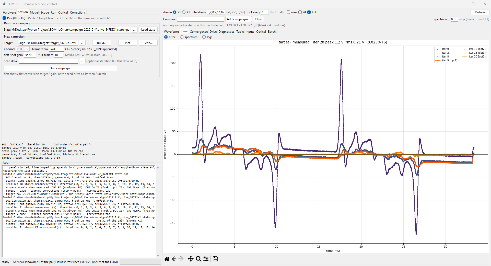

The left column holds the settings in seven tabs, in the order a campaign uses them. Under the tabs are the session
summary, the log and the status line. They are always visible. The right side is the plot notebook.

| left tab | what it is for |
|---|---|
| Hardware | one look at the rack: Scope, AWG, ELL14 analyzer, DS345. |
| Session | load a state file, or start a new campaign. The **Pair (X1 + X2)** tick and the **Echo...** button are here. |
| [Model](docs/handbook/tab_model.png) | what the update divides the error by (the model ladder, gain, `f_cut`, notches, the measured FRF). |
| Scope | the scope channel roles (which scope channel is the PD, the monitors and the drives), the capture settings and the mains-ripple switch. There is no tab called Settings. |
| Run | the bench loop: Auto-set, Upload, Run, Hold, and the buttons for **Batch...**, **Manual step...** and **Bench settings...**. |
| Optical | the optical close by hand, in seven numbered steps. Pair mode only. |
| [Corrections](docs/handbook/tab_corrections.png) | learned changes to the target, from a measurement made elsewhere. |

The right-hand plot notebook has the tabs Waveforms, Error, Convergence, Drive, Diagnostics, Table, Inputs, Optical and
Batch. Several of them have a view bar on top (for example Error has error, spectrum and legs). Above the notebook:

- **shown X1 / X2** says which chain of a pair the plots and the summary show.
- **Iterations** picks which stored iterations are overlaid. Blank is the last two, `all` is everything, `2-5` a range,
  `0,3,6` a list. Press Enter or **Redraw**.
- **Compare** overlays other campaigns, read-only.

To look at a finished campaign: tick **Pair (X1 + X2)** on the Session tab, put the X1 state file in **State**
(`run\campaign-20261014\drive_S47E2X1.state.npz`) and press **Load state**. The X2 file is found by name
(the last `X1` becomes `X2`).

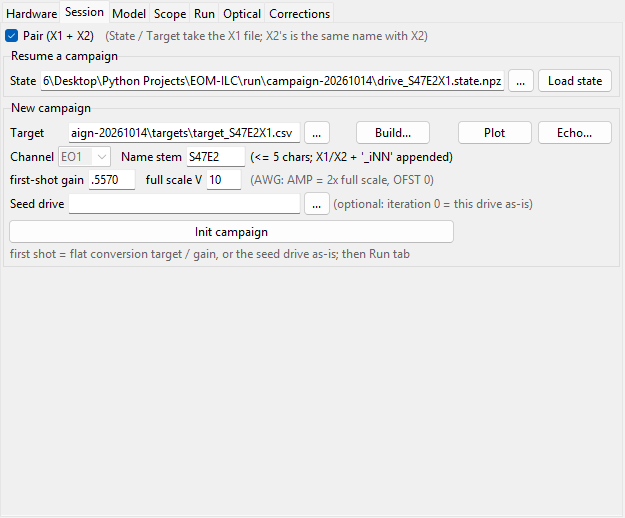

### 1.3 The Hardware tab

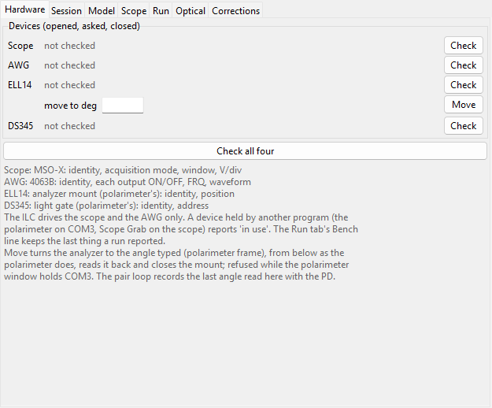

Each row has a **Check** button. A check opens the device, asks its identity and how it stands, then closes it again.
The answer and the time are written into the row: green when it answered, red when it did not.

| row | what the check reads |
|---|---|
| Scope | MSO-X: identity, acquisition mode, window, volts per division. |
| AWG | 4063B: identity, each output ON or OFF, FRQ, selected waveform. |
| ELL14 | the analyzer mount (the polarimeter's): identity and position. |
| DS345 | the light gate (the polarimeter's): identity and address. |

**Check all four** runs the four in a row. A check never moves or programs anything. The one control on this tab that
moves something is **Move**: it turns the analyzer to the angle typed in "move to deg".

A device held by another program reports "in use". The usual cause is the polarimeter window holding COM3, or Scope Grab
holding the scope.

**"Instruments closed"** is a line the Log prints when any run that used the scope or the AWG ends. It means the panel has
released both, so another program may open them. The Optical-tab steps print "instruments closed (outputs left as they
were)": closing the instruments never switches an output.

Buttons that open an instrument: the Hardware checks and Move, Auto-set, Upload, Run bench loop, Hold, the Optical steps,
Run on bench in the Batch window, and the line-ripple measurement. Everything else works from files and
is safe with the bench off: Load state, all the plots, Echo... and New plan..., Check plan, Preview, Simulate and
Export for Supertime.

---

## 2. Bench preconditions before any run

Work down this list before the first campaign of a day.

### 2.1 The AWG: Auto-set

1. Both generator outputs are OFF at the start of a fresh bench session. If one is ON, read the safety box below before
   you do anything about it.
2. Run tab, **Auto-set instruments**. It writes the known-good setup from the session: the arb frequency, AMP 20 Vpp,
   OFST 0, DDS, load HZ and the one-cycle burst on the external trigger. On the scope it sets a window 1.3 times the
   record, HRES acquisition and the vertical scales. It refuses while an output is ON, and it never switches an output
   or touches the trigger.
3. The batch does not set AMP, OFST, load, clock or burst itself. It only checks them before every campaign and refuses
   a campaign that does not match. So Auto-set has to be done once, by you.

### 2.2 The trigger: the DS345 rate

The DS345 makes the trigger that fires the record. The panel does not set its rate. Set it by hand:

| record | trigger rate |
|---|---|
| spin-echo records (every campaign in this handbook) | **1.0104 Hz** |
| single transports | 3.7 Hz |

Two reasons for 1.0104 Hz:

- **Never a divisor of 60 Hz.** At exactly 1.000 Hz every shot lands on the same mains phase, so the 64-shot average keeps
  the 60 Hz ripple and the loop learns it as if it were error. 1.0104 Hz is 60 divided by 59.382: the mains phase moves by
  0.382 of a cycle per shot, so the shots spread over the cycle.
- **More than 0.5 s between shots.** The crystal remembers the previous shot (creep time constant about 70 ms). At about
  1 Hz, leg 1 meets a relaxed crystal, as it does in the experiment, which runs at about 6 s.

The plan's `timing.trigger_hz` is used only for the time estimate. It does not set the generator.
The titles in the Preview plot show "FRQ 29.999 Hz". That is the AWG repeat frequency for a 33.334 ms record, not the
trigger rate.

### 2.3 Light and analyzer (for the optical close)

- Light on and the beam unblocked. Before every scan the panel takes one single shot and refuses the scan if the PD never
  rises above 50 mV ("the light is off or the beam is blocked").
- The analyzer (ELL14) answers on **COM3**. The polarimeter window must be closed, or the panel reports "in use".
- The scope program must be the headless one, **scope-grab-multi**. With the old checkout a scan is refused by name.

### 2.4 Scope channels

On the **Scope** tab the four channels are roles, not numbers. The bench as wired since 5 October:

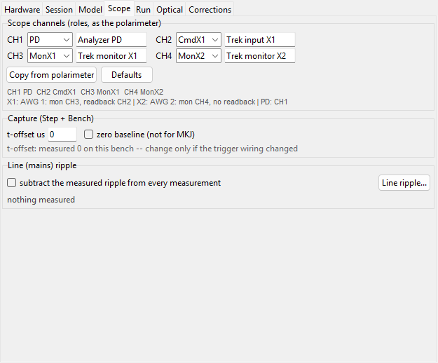

| channel | role | carries |
|---|---|---|
| CH1 | PD | analyzer photodiode |
| CH2 | CmdX1 | the X1 drive, as the Trek input |
| CH3 | MonX1 | Trek monitor X1 |
| CH4 | MonX2 | Trek monitor X2 |

The **Defaults** button sets exactly this. **Copy from polarimeter** takes the polarimeter's map instead. A role on two
channels is refused. With no `CmdX2`, X2's trigger alignment is not verified, and the Run tab's Bench line says so
("readback none (alignment not verified)"). That is the present wiring.

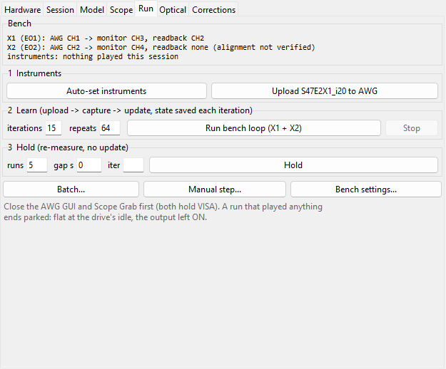

### 2.5 Safety rules for the AWG and the Treks

> **Never let an AWG output float.** Either output may feed a stage that drives the Treks high (minus 4 to minus 5.7 kV)
> when its input floats. Stopping therefore means parking, not switching off.

What the software does, as the code stands on 28 October:

- The batch, the panel's bench loop and the optical steps never switch an output OFF on their own. At the end of a
  campaign, between campaigns, on an error and on Stop, each channel it played on is **parked**: a flat record at the
  drive's idle level (uploaded as `PARK1` / `PARK2`), output left ON.
- Outputs go ON only after a confirmation: a Yes/No dialog in the Batch window, a typed `YES` on the command line.
- OFF happens only as an explicit act: the Optical tab's **7 Outputs OFF** (it asks first), or the batch's
  `--outputs-off-at-end` flag (named in the typed confirmation).
- Switch an output OFF by hand only with every stage it feeds bypassed.

If a headless run is killed, the process cannot park its own outputs. Run `tools\awg_park.py`:

```
C:\ProgramData\anaconda3\python.exe tools\awg_park.py
```

It uploads a flat idle record on each channel and leaves the outputs as they were. Wait about 60 s after killing the batch
first: the generator refuses while another process still holds it. `tools\awg_outputs_off.py` is the OFF counterpart. It asks
for a typed `OFF` that names both channels and belongs to the case where every stage the outputs feed is bypassed.

The lab's other standing rule: a waveform nobody has played before is first played into the oscilloscope and checked,
before it may drive the Treks. `ilc_batch.py ... --dry-run` is a software check. It opens no instrument and does not
replace that. The campaign targets were limit-checked by the dry run. Ask Maarten whether a new target set needs the
scope-first play.

Do not change the trigger rate, the AWG amplitude, offset or load, or the Trek limits during a campaign.

---

## 3. Targets and spin-echo records

### 3.1 Target pairs

A campaign needs one pair of CSV files in one folder:

```
target_<stem>X1.csv
target_<stem>X2.csv
```

Each has columns `time_us,voltage_V`, with `#` comment lines allowed. The values are volts at the EOM (thousands of
volts, for example peaks near 5128 V for X1 and 5137 V for X2). Both files must be on the same time grid (2 us).

The campaign targets live in `Share Data\Ramps\campaign-20261014\targets\`. Do not edit them to make a campaign pass.

### 3.2 Why a record has two legs

With an identical drive, a spin echo's second transport rotated by +0.12 to +0.18 degrees against the first (30 September
to 1 October 2026): the crystal remembers leg 1. A transport trained alone is learned on a rested crystal. So both legs
are trained in one record, at the echo's spacing, and the loop learns leg 2 in the state leg 1 leaves behind.

### 3.3 Building an echo record: the Echo... dialog

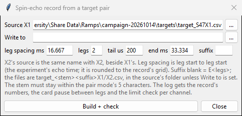

On the Session tab, **Echo...** is next to the Target box.

1. Put the X1 target of a one-transport pair in the Target box (for example `target_S47X1.csv`). X2's source is the
   same name with `X2`, beside it.
2. Open **Echo...**. The defaults are leg spacing 16.667 ms, 2 legs, tail 200 us, end 33.334 ms, suffix blank.
3. Press **Build + check**. The files `target_<stem>E2X1.csv` and `target_<stem>E2X2.csv` are written (suffix blank means
   `E` plus the number of legs). The Target box then holds the new X1 file and the stem box its name, ready for a pair Init.
   The log gets the record's numbers, the card pause between the legs and a PASS or FAIL limit check per channel.

What the builder does:

- The transport is where the target is above 0.1 % of its maximum, widened to the whole ramp.
- The record is the source's lead, transport 1, idle until leg 2 starts one spacing after leg 1, transport 2, and a tail.
- The spacing is rounded to the 2 us grid: **16.667 ms becomes 16.668 ms**.
- With **end ms** 33.334 the record is padded with idle to the whole two-leg echo: **16667 points** at 2 us.
- S47E2: leg 1 starts at 0.200 ms, leg 2 at 16.868 ms.
- A spacing shorter than the transport, sources on different grids, and a source that already holds two transports
  are refused.

The padding matters. The crystal's memory keeps the light rotated for tens of milliseconds after a fall, and the optical
comparison runs over the whole record. The padding is idle the card does not play (section 6.4).

A batch plan builds the same record itself, from its `"echo"` key (section 4.2). The command-line twin is
`tools\make_echo_target.py`.

### 3.4 Limits to know

- **Stem length.** Pair mode appends `X1` / `X2` to the stem, and the generator's waveform names are limited to 11
  characters (past that the 4063B's front panel wedges until it is power-cycled). A stem is therefore at most 5
  characters in pair mode. `S47E2` is exactly 5.
- **Stems over 5 characters train under cut AWG names.** The batch cuts the name to 5 characters: `RS25E2` trains as
  `RS25E`, `SF130E2` as `SF130`, `N175E2` as `N175E`, `D2N1400E2` as `D2N14`, `SW100E2` as `SW100`, `HSERE2` as `HSERE`,
  `R3410E2` as `R3410`. The state files carry the cut name (`drive_SF130X1.state.npz`). The batch refuses two stems that
  would collide after the cut; shorten the suffix instead.
- **Arb memory.** The 4063B holds 8 Mpts per arbitrary waveform (measured 8 October). A 16667-point record is far inside it.
  The batch uploads into two alternating slots per channel (`BX1A` / `BX1B`, `BX2A` / `BX2B`) because the generator cannot
  delete a stored waveform remotely. Every iteration is still on disk as `drive_<stem>X1_iNN.csv`.

---

## 4. The Batch window

Run tab, **Batch...** opens the window. It can be closed and reopened while a batch runs.

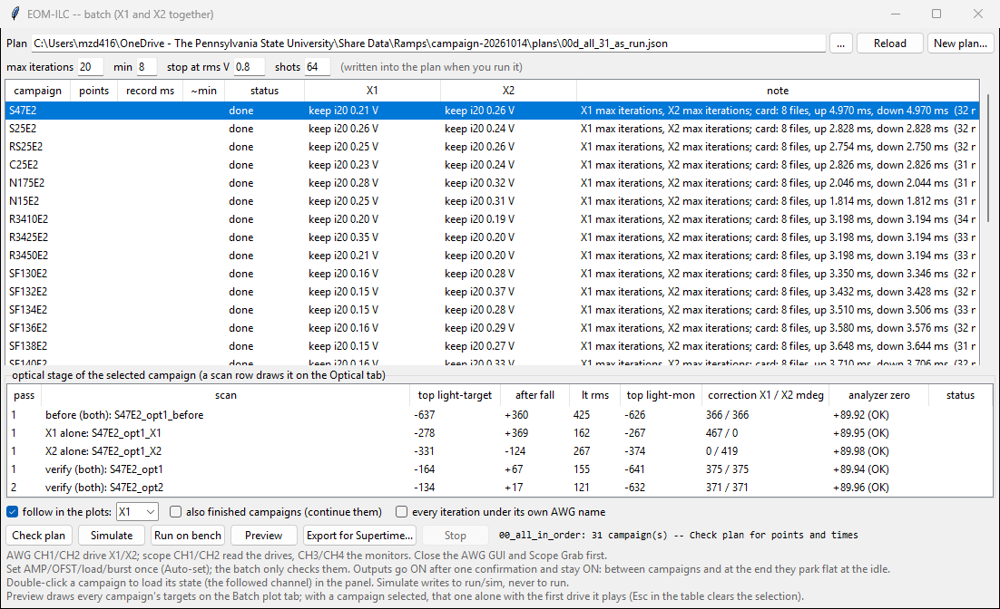

Top to bottom:

1. **Plan** row: the plan file, `...` to browse, **Reload**, **New plan...**.
2. The loop numbers: **max iterations**, **min**, **stop at rms V**, **shots**. They are written into the plan file
   when you run it, so the plan stays the record of how the batch was trained.
3. The campaign table: campaign, points, record ms, estimated minutes, status, the X1 and X2 keeper (iteration and rms),
   a note.
4. The optical-stage table of the selected campaign (chapter 7).
5. **follow in the plots** (X1 or X2), **also finished campaigns (continue them)**, **every iteration under its own AWG
   name**.
6. The buttons: **Check plan**, **Simulate**, **Run on bench**, **Preview**, **Export for Supertime...**, **Stop**, and
   the status line.

Double-click a campaign to load its state in the panel.

### 4.1 New plan...

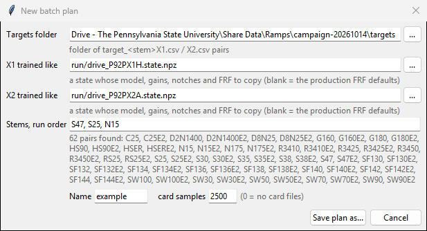

1. **Targets folder**: a folder of target pairs. The dialog lists the pairs it finds.
2. **X1 trained like / X2 trained like**: a state file whose model, gain, `f_cut`, notches and FRF the plan copies. The
   campaign used `run/drive_P92PX1H.state.npz` and `run/drive_P92PX2A.state.npz`. Blank means the production FRF defaults.
3. **Stems, run order**: comma separated. The order is the run order.
4. **Name** and **card samples** (2500; 0 means no card files).
5. **Save plan as...**.

The dialog writes a basic plan. The `echo`, `optical` and `timing` blocks below are added by editing the JSON. The
simplest start is a copy of `plans\00d_all_31_as_run.json`.

### 4.2 The plan file

The plan of the 14-15 October campaign, shortened to three campaigns:

```json
{
  "name": "00_all_in_order",
  "targets_dir": "../targets",
  "run_dir": "run/campaign-20261014",
  "settings": {
    "X1": {"from_state": "run/drive_P92PX1H.state.npz"},
    "X2": {"from_state": "run/drive_P92PX2A.state.npz"}
  },
  "loop":   {"repeats_early": 16, "early_rms_v": 2.0},
  "timing": {"trigger_hz": 1.0104},
  "optical": {
    "attribution": "separate",
    "gains": [1.0, 1.0, 1.0],
    "iterations": 4,
    "band_hz": 5000,
    "pd_delay_us": 1.7,
    "split": 0.5,
    "cap_v": 150,
    "scan": {"angles": "0:359:22.5", "shots": 8, "sample_us": 2.0,
             "solo_angles": "0:179:22.5", "verify_angles": "0:179:22.5"}
  },
  "card": {"n": 2500, "settle_us": 200},
  "campaigns": [
    {"stem": "S47", "echo": {"spacing_ms": 16.667, "end_ms": 33.334}},
    {"stem": "S25", "echo": {"spacing_ms": 16.667, "end_ms": 33.334}},
    {"stem": "N15", "echo": {"spacing_ms": 16.667, "end_ms": 33.334}}
  ]
}
```

| key | meaning |
|---|---|
| `targets_dir` | where the target pairs are, relative to the plan file. |
| `settings.X1/X2.from_state` | the state whose model and settings each chain learns with. The two chains are different amplifiers and get different models. Without these states every campaign is refused. |
| `loop` | the stop rules and shot counts. Defaults: `max_iterations` 20, `min_iterations` 8, `stop_rms_v` 0.8, `repeats` 64. `repeats_early` 16 takes 16 shots while the error is large (section 6.1). |
| `timing.trigger_hz` | the trigger rate, for the time estimate only. |
| `optical` | the optical close. A campaign can carry its own block, which wins; `"optical": false` in a campaign switches a root block off for it. |
| `optical.attribution` | `separate`: each crystal is measured alone. `joint` (the default) scans both together and splits one residual by `split`. |
| `optical.gains` | one gain per pass: three passes at 1.0. |
| `optical.iterations` | learning iterations after each applied correction (4 in the campaign). |
| `optical.band_hz` | the comparison's low-pass and the correction's band (5 kHz). |
| `optical.pd_delay_us` | the photodiode's own delay, removed before the comparison (1.7 us). |
| `optical.cap_v` | the largest correction allowed at the EOM (150 V). |
| `optical.scan` | `angles` is the analyzer angles `start:stop:step` (`0:359:22.5` is 16 angles). `solo_angles` and `verify_angles` are the half circle `0:179:22.5` for the X1-alone, X2-alone and verification scans. `shots` is the single shots per angle. |
| `card` | cut the card files at `n` samples with a `settle_us` of 200 (section 6.4). |
| `run_dir` | where states, drives, measurements, the manifest and the optical folders go. A new `run_dir` means a new campaign never resumes or overwrites an older one. |
| `campaigns[].echo` | builds the two-leg record from the one-transport pair when the plan loads. The campaign then goes on as `<stem>E2`. An identical file already in the targets folder is left alone. |
| `campaigns[].awg` | the AWG name; set automatically when a stem is over 5 characters. |

### 4.3 Check plan, Preview, Simulate, Run on bench

**Check plan.** Loads the plan without any instrument and fills the table: points, record length and a time estimate per
campaign, and any problem. The window's totals are the estimate at the iteration cap (the campaign plan reads about 15.4
hours for 31 campaigns at the cap). The numbers typed in the window are used but not written into the plan.

**Preview.** Draws the plan on the **Batch** plot tab. Check here what the batch will fit to before anything runs.

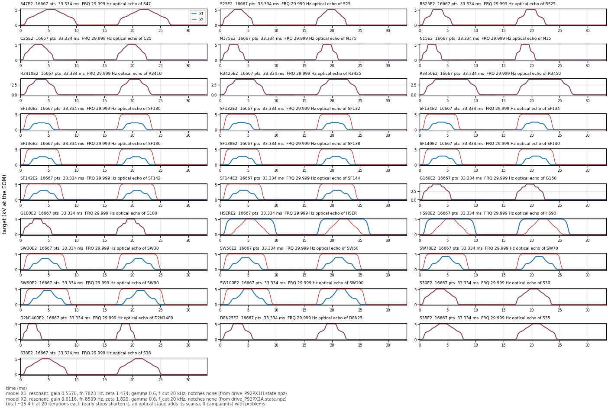

With nothing selected: one small panel per campaign, both targets in kilovolts at the EOM against ms, titled with the
stem, number of points, period and AWG frequency, plus `optical` and `echo of <source>`. A campaign with a problem
carries it in red. Under the grid are each channel's model line and the total time.

Select a campaign row first and Preview draws that campaign alone:

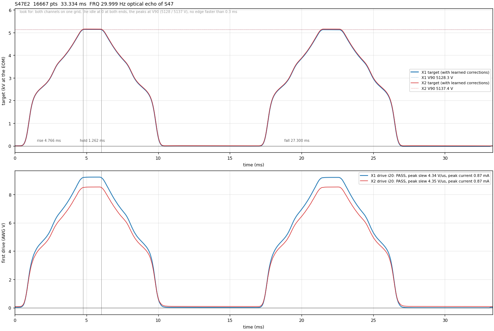

Top: its targets with the ramp's start, top, hold end and fall end marked, and each channel's V90 dotted. Bottom: the
first drive each channel will play (the flat first shot, or the state's current drive when the campaign resumes) with the
limit check's verdict, peak slew and peak current in the legend. Look for: both channels on one grid, the idle at 0 at both
ends, the peaks at V90 (5128 / 5137 V), no edge faster than 0.3 ms. **Esc** in the table clears the selection.

**Simulate.** Runs the plan on the simulated bench. Files go to `run\sim`, never to `run`, so a simulated state cannot be
mistaken for a measured one. It proves the sequencing, not the physics.

**Run on bench.** Drives both Treks.

1. Close the AWG GUI and Scope Grab. Work through chapter 2.
2. Press **Run on bench**.
3. A dialog names the campaigns still to do (finished ones are skipped unless **also finished campaigns** is ticked) and
   the time at the iteration cap. Read it. It states that the outputs are never switched OFF. **Yes** switches CH1 and CH2 ON for the
   batch.

After Yes, for each campaign the batch does this: parks any live output flat, sets FRQ, uploads both drives and checks
the generator setup, switches the outputs ON if they are not, reads the analyzer angle once (it never moves it), iterates,
runs the optical stage, writes the card files and parks both outputs.

### 4.4 Status line, progress bar, Stop

The window's status line reads like this:

```
S47E2 2/6 | i05 of <=20 (X1 0.54 V, X2 0.58 V) | elapsed 12 min | this campaign ~9 min left (at the iteration cap) | batch ~2:10 h left
```

During the optical close it reads `optical pass 1: scan S47E2_opt1_X1 (2/5)`. The progress bar runs over the plan's
campaigns and moves inside the current one. The time left is the plan's estimate corrected by what this run measured: the
iteration time from the gaps between iterations, the scan time from the gaps between optical events, and for the queued
campaigns the plan's totals scaled by what the finished ones really took. The main window's status line carries a short
form.

**Stop** (the panel's or the window's) ends the batch at the next shot. Both outputs park, ON. States are kept, and
running again resumes.

### 4.5 Resuming, redoing, changing targets

- **Resume.** A plan resumes from its manifest and from the states. A finished campaign is skipped. An interrupted one
  carries on from its states, earlier measurements included, so the keeper is chosen from the whole campaign. In the optical
  stage, a pass whose verification scan is complete on disk is not repeated, and an unfinished scan resumes where it stopped.
- **Redo.** `--redo` on the command line, or the **also finished campaigns (continue them)** tick in the window, repeats
  campaigns the manifest lists as done.
- **Changed targets.** If a target file changed, the runner refuses the campaign: `<state> exists but holds a different
  target than <file>; move it aside or rename the campaign`. Archive the old states first. On 15 October the 14 records
  whose X2 targets were rebuilt had their old states moved to `run\campaign-20261014\archive_X2_99deg\`, and the
  rebuilt plan ran with the same plan name and `--redo`, so the manifest entries lined up.
- **Manifest.** Progress is recorded in `<run_dir>\batch_<plan name>.json`. Do not edit it.

---

## 5. Running headless from the command line

The 14-15 October campaign ran this way, so that a long run does not depend on the panel window. Both ways run the same
code and the same state files.

All commands run from the EOM-ILC folder with the Anaconda interpreter.

1. **Dry run first.** No instrument is opened.

   ```
   C:\ProgramData\anaconda3\python.exe ilc_batch.py run "<plan>.json" --dry-run
   ```

   Expected for the campaign plan: one `echo <stem>E2: spin echo of <stem>, 2 legs ...` line per campaign with the record's
   points and the card pause, the two model lines, one `optical:` line per campaign, the total time, and no `REFUSED`.
   Stop and ask if a campaign is refused.

2. **Run.** Put the console output in a file in the run folder, so the log survives and the report tool can read it:

   ```
   C:\ProgramData\anaconda3\python.exe -u ilc_batch.py run "<plan>.json" --allow-output-on > "run\campaign-20261014\batch_all.log" 2>&1
   ```

   (Command Prompt syntax.) Without `--yes` the program asks you to type `YES`. It says that the outputs go ON and stay
   ON, parked between campaigns and at the end. The campaign brief says to add `--yes` only when Maarten has said to. It
   skips that question, which is what an unattended run needs, because the program would otherwise wait for a person. The
   14-15 October run used it.

3. **Other flags.** `--simulate` (simulated bench), `--no-optical` (campaigns end at their electrical keepers),
   `--redo`, `--outputs-off-at-end` (named in the confirmation; only with every stage bypassed), `--gui-names`.

4. **While it runs.** The panel may stay open but idle. Do not press Run, the Hardware checks, Move, Auto-set or any
   Optical step while a headless batch holds the instruments. Follow the run by reading the log file. Ctrl-C ends it the
   same way Stop does: the channels it played on park.

5. **If the process is killed**, park the outputs with `tools\awg_park.py` (section 2.5) and wait about 60 s before the
   generator answers again.

The command-line plan builder, if you want one without the dialog:

```
C:\ProgramData\anaconda3\python.exe ilc_batch.py make-plan --targets <folder> --stems S47,S25,N15 --x1-from run\drive_P92PX1H.state.npz --x2-from run\drive_P92PX2A.state.npz --name mine --card 2500 --out <folder>\batch_mine.json
```

The brief of the campaign (`START_HERE.md`) asks for these checks before the first plan: the EOM-ILC checkout is at
`d0c89a2` or later (the plans use `solo_angles`, `verify_angles` and the three-pass optical stage), and the two P92
state files exist in `run\`.

---

## 6. What a campaign does

Each campaign has an electrical loop, then the optical close. Roughly 31 minutes per campaign were measured on 14-15
October.

### 6.1 The electrical loop

Both drives play at once. Both monitors are read from the same frozen acquisitions. Each channel's loop learns from its own
monitor. Per iteration the loop averages up to 64 single shots, computes the error, updates the drive, checks it against
the Trek limits, uploads it and saves the state.

- **Early iterations use fewer shots.** With `repeats_early` 16, iteration 0 and every iteration while the last rms of any
  active channel is above `early_rms_v` (2 V) takes 16 shots. The error is then far above what 64 shots resolve. The log line
  says `(16 shots, early)`.
- **The last allowed iteration is always at the full shot count**, so the keeper is never a 16-shot measurement.
- **Per channel, it stops at the first of:** the iteration cap (20); rms at or below `stop_rms_v` (0.8 V) after
  `min_iterations` (8); a plateau (the loop re-learning noise); nothing left above the noise floor; three measurements in a
  row more than twice its best rms (it goes back to its best drive); a drive failing the limit check. The channel that
  stops first keeps playing its last drive until the other is done.
- **The keeper** is the measured iteration with the lowest rms at or after `min_iterations`.
- **The PD is recorded on every iteration** (`meas_<stem>PD_iNN.npy`). The analyzer sits still, so the PD shows how the
  light answered each update. The Diagnostics -> pd view draws it (chapter 7).

### 6.2 The optical close

The loop makes the monitors follow the target. The light leaves the monitors by amounts that no monitor shows, at the ramp
top and after the fall. The optical stage measures that and moves the targets.

With `"attribution": "separate"` and three passes (the 14-15 October plan), per campaign:

1. **Before scan** (both crystals playing, full circle `0:359:22.5`): `<stem>_opt1_before`. Recorded, not applied.
2. **Pass 1, X1 alone.** X2's channel is parked flat at its idle, its output stays ON. Scan `<stem>_opt1_X1`. The whole
   light-minus-monitors goes to X1.
3. **Pass 1, X2 alone.** X1 is parked, X2's keeper plays. Scan `<stem>_opt1_X2`.
4. **Correction applied.** Each crystal's correction (minus light-minus-monitors, low-passed at 5 kHz, gain 1.0, capped at
   150 V) moves its target. Both files go on, or neither.
5. **Learning iterations.** Four iterations of the normal loop learn the moved targets, with both keepers playing again.
6. **Verification scan** (both playing, half circle): `<stem>_opt1`.
7. **Passes 2 and 3.** Each applies the joint verification's residual: the joint correction minus each crystal's share of
   what is already applied. It goes in its own slot, `joint2`, `joint3`. Then four learning iterations and a verification
   scan, `<stem>_opt2` and `<stem>_opt3`.

Why not simply repeat the pass: light minus monitors is a fresh estimate of the whole error every time, because moving the
target moves the monitors and the light together. Applying the same file again, or adding it on top, would apply the
correction twice. That is why later passes apply the residual rule.

The keeper after the optical stage is the last measured iteration after the last applied correction. Iteration numbers keep
counting through the optical stage, so a campaign's keeper reads i20 in the table. A refused correction ends the stage for
that campaign, is recorded, and the campaign keeps the keeper it had.

Times measured on 14 October: a 64-shot iteration at 1.0104 Hz is 65 s; a 21-step by 8-shot scan is about 3.2 minutes.

### 6.3 The analyzer zero

Each scan fits the analyzer's rest polarization. The optical table's **analyzer zero** column reads about +90 with `(OK)`
when the zero is within 1 degree of crossed plus 90. `(OFF x)` means the analyzer zero is off by x degrees.

### 6.4 The card files and the card pause

If the plan has a `card` block, the batch cuts the closed drive into four files per channel for the experiment's control
card, next to the keepers:

```
run\campaign-20261014\keep\drive_S47E2X1_keep.csv                (the keeper, full record)
run\campaign-20261014\keep\drive_S47E2X1_keep_leg1_upramp.csv
run\campaign-20261014\keep\drive_S47E2X1_keep_leg1_downramp.csv
run\campaign-20261014\keep\drive_S47E2X1_keep_leg2_upramp.csv
run\campaign-20261014\keep\drive_S47E2X1_keep_leg2_downramp.csv
```

(and the same for X2). Both channels are cut at the same times for each leg, around the leg's common flat stretch. The
log prints each file's span, which is exactly the ramp time to program, and the **card pause** between the legs:

```
card hold         = hold on the atoms - 2 x settle
pause after leg k = spacing - (up span + card hold + down span)
```

For S47E2 at the 200 us settle: up 4.970 ms, card hold 0.872 ms, down 4.970 ms, pause 16.668 - 10.812 = **5.856 ms**.
That pause is exactly the idle the loop trained between leg 1's down file and leg 2's up file. The pause must equal the
`card_pause_ms` column of the campaign manifest within 2 us. A mismatch is a stop-and-report.

### 6.5 What a campaign leaves behind

| file | where | what |
|---|---|---|
| `drive_<stem>X1.state.npz`, `...X2...` | run folder | the campaign's memory, rewritten every iteration |
| `drive_<stem>X1_iNN.csv` | run folder | each iteration's drive |
| `meas_<stem>X1_iNN.npy` | run folder | each iteration's averaged monitor |
| `meas_<stem>PD_iNN.npy` (+ `_stats.npz`) | run folder | the analyzer PD per iteration |
| `keep\drive_<stem>X1_keep*.csv` | run folder | keepers and the card split files |
| `optical\<stem>_opt1_before\` etc. | run folder | each scan, in the polarimeter's folder format, with its comparison in `analysis\target_compare\` |
| `optical\<stem>_optical.json` | run folder | the optical record: per pass the scans, the files applied, `verdict_before` and `verdict_after` |
| `batch_<plan name>.json` | run folder | the manifest: every campaign's status, stop reasons and history |
| `batch_all.log` | run folder | the console log of a headless run (the name is yours to choose) |

A state is loadable in the panel with **Load state** and can be continued by hand.

### 6.6 The same close, by hand

The Optical tab runs the same stages one at a time on the loaded pair (pair mode only): **1 Play** (both, X1 alone or X2 alone),
**2 Scan**, **3 Compare**, **4 Apply to the targets**, **5 Learn**, **6 Verify**, **7 Outputs OFF**. Each step is greyed, with the
reason in orange under it, until the step before has a result. The outputs go ON at step 1 and stay ON until step 7, which
asks first. `REFERENCE.md`, section 8, has the full procedure and every field of the tab. The batch runs the same code over every campaign of a
plan.

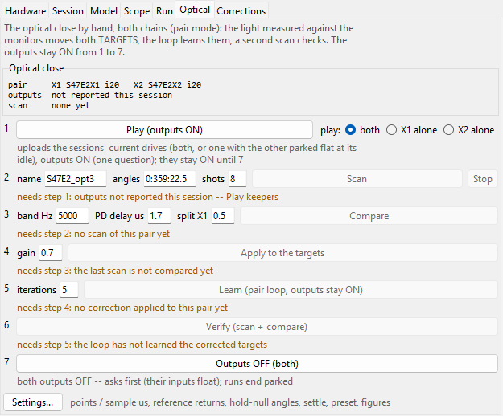

---

## 7. Reviewing results in the panel

### 7.1 Following a running campaign, or reviewing another

While a batch runs, the Batch window's table and the passes view follow the running campaign, and (with **follow in the
plots** ticked) the plots reload the running campaign's X1 or X2 after every iteration. To review a different campaign
than the running one, select its row. That switches **follow in the plots** off, because following would pull the running
state back into the plots at the next iteration, and the status line says so. Everything comes from disk, so reviewing
works during the run, after it and after a restart. Double-click a campaign to load its state (tick **Pair** first to get
X1 and X2).

### 7.2 The optical stage table

Select a campaign row. The table under the campaigns has one row per scan of its optical record, in the order they ran.

| column | meaning |
|---|---|
| pass, scan | the pass number, and `before (both)` / `X1 alone` / `X2 alone` / `verify (both)` with the scan's name |
| top light-target | the worst transport's light minus target at the ramp top, mdeg |
| after fall | the same in the first ms after the fall |
| lt rms | rms of light minus target |
| top light-mon | light minus monitors at the top |
| correction X1 / X2 | the correction applied to each crystal, mdeg |
| analyzer zero | the analyzer zero check (section 6.3) |

**Which number to judge by.** The report's figure for a campaign is written `hold a -> b (edge c -> d)`:

- The **hold number** is light minus target averaged over the inside of the flat top (0.2 ms clear of both ends), the worst
  of the two transports. It is the one to judge a campaign by.
- The **edge number** is the verdict's ramp-top extreme, which includes a 0.3 ms pad at the top's edges. The comparison's
  time-map artefact at the ramp edges dominates it.

In the panel's table the columns are the verdict's edge extremes. For S47E2 the table shows -637 mdeg before and, after the
third pass, -108 (the sixth row; scroll the small table). The report's hold number for the same campaign reads -497 before
and +48 after. The two numbers are read from different windows of the same scans.

### 7.3 The Optical views

Select the campaign row to draw **Optical -> passes**. Select a scan row to draw that scan's views. All six views are on
the Optical plot tab's view bar.

**passes.** The campaign's optical stage at a glance.

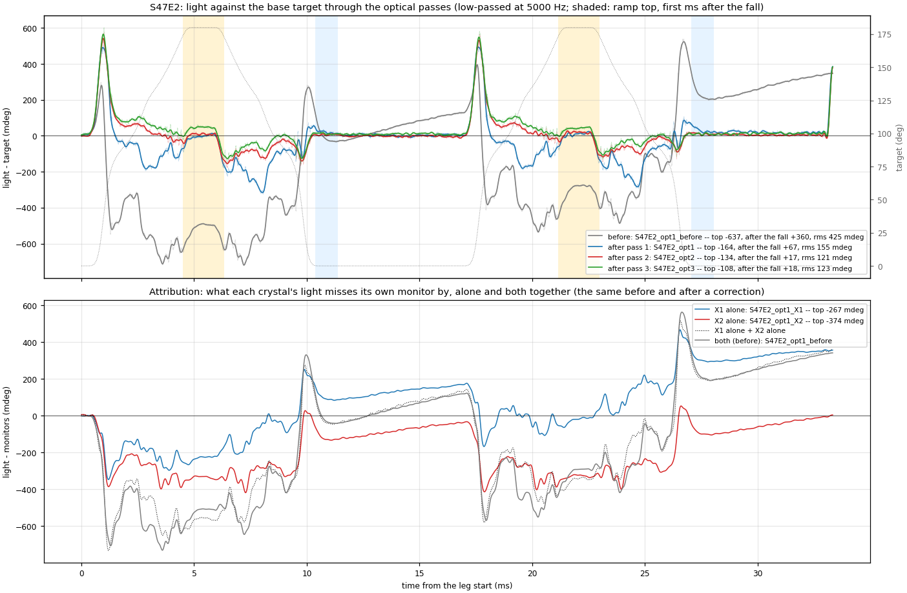

Top: light minus target over the record, for the before scan (grey) and after every pass (one colour each; thin is raw,
thick is low-passed at 5 kHz; the legend carries each scan's ramp-top, after-the-fall and rms numbers). The base target is
dotted on the right axis. The windows the verdict reads are shaded: ramp top in yellow, first ms after the fall in blue,
per transport. Bottom: attribution. Light minus monitors with X1 alone, X2 alone, their sum dotted and both together in
grey. Light minus monitors is the same before and after a correction (the monitors move with the light), so the top panel
is where a pass shows.

**scan live.** While a batch scan runs, every 4 seconds the scan folder is read and the PD intensity per analyzer angle
measured so far is drawn, with the light's rotation fitted from those angles (from the third angle on). It draws nothing
when no scan is running.

**legs.** The spin echo's second leg against its first, for the light:

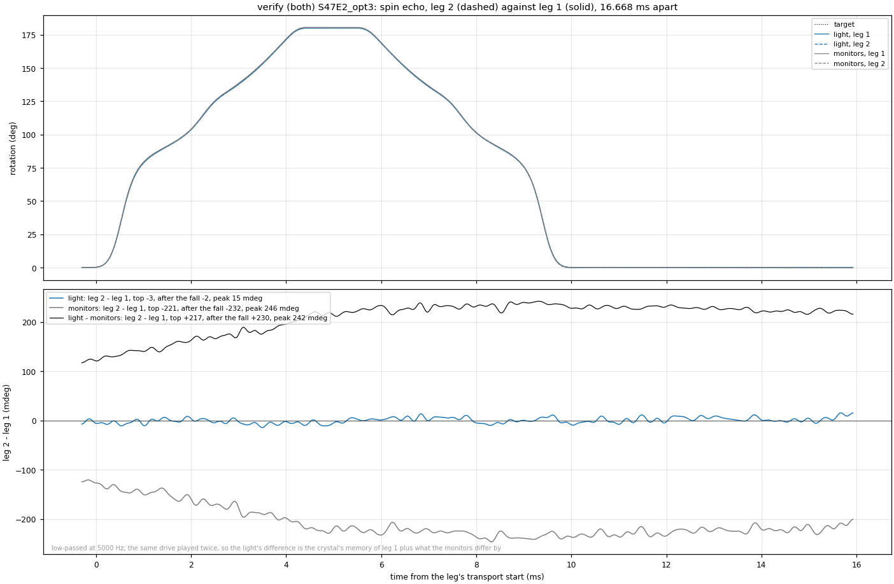

Top: the rotation of light and monitors on leg 1 (solid) and leg 2 (dashed) with the target. Bottom: leg 2 minus leg 1 of
the light, of the monitors and of light minus monitors, low-passed at the band, with each one's mean over the ramp top,
over the first ms after the fall, and its peak (mdeg). The light's difference is the check that the two legs come out
the same. The same drive played twice leaves the light's leg 2 about 0.1 to 0.2 degrees off leg 1 (section 3.2). In the figure
above, the light's leg 2 minus leg 1 reads -3 mdeg at the top, while the monitors' difference reads -221 mdeg: the close
drives the monitors differently on leg 2, and the light then comes out the same on both. The last 0.3 ms before the
record's end are left out.

**rotation, correction, before / after.** A scan's light, monitors and target in degrees with light minus monitors below
it:

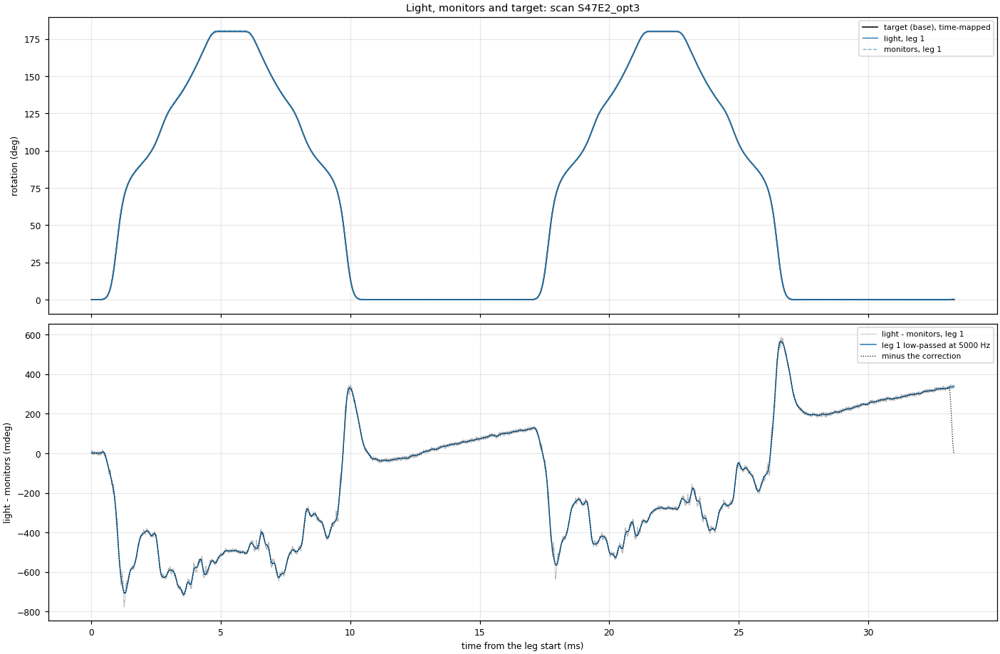

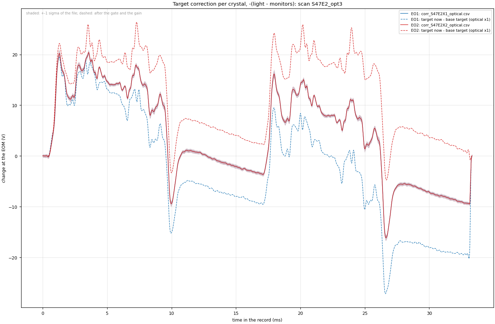

The before / after view compares the ramp-top, after-the-fall and rms numbers of a verification against the joint scan
before it:

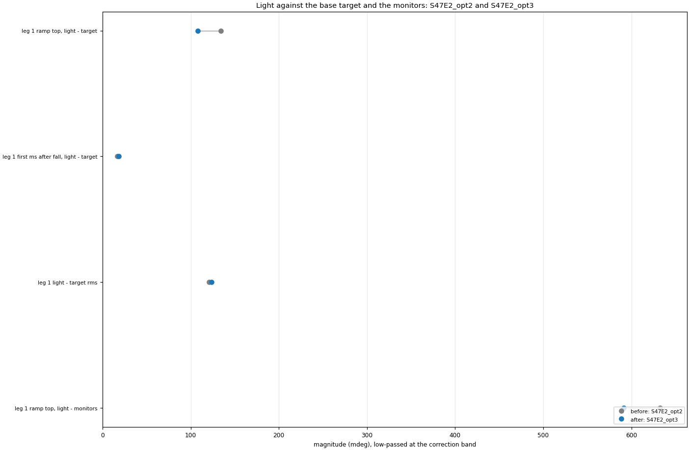

### 7.4 Error -> legs

The electrical counterpart on the Error tab. For a two-leg record it plots, per selected iteration, target minus measured
over leg 1 (solid) and leg 2 (dashed), and below it the measured monitor's leg 2 minus leg 1 and the drive's leg 2 minus
leg 1.

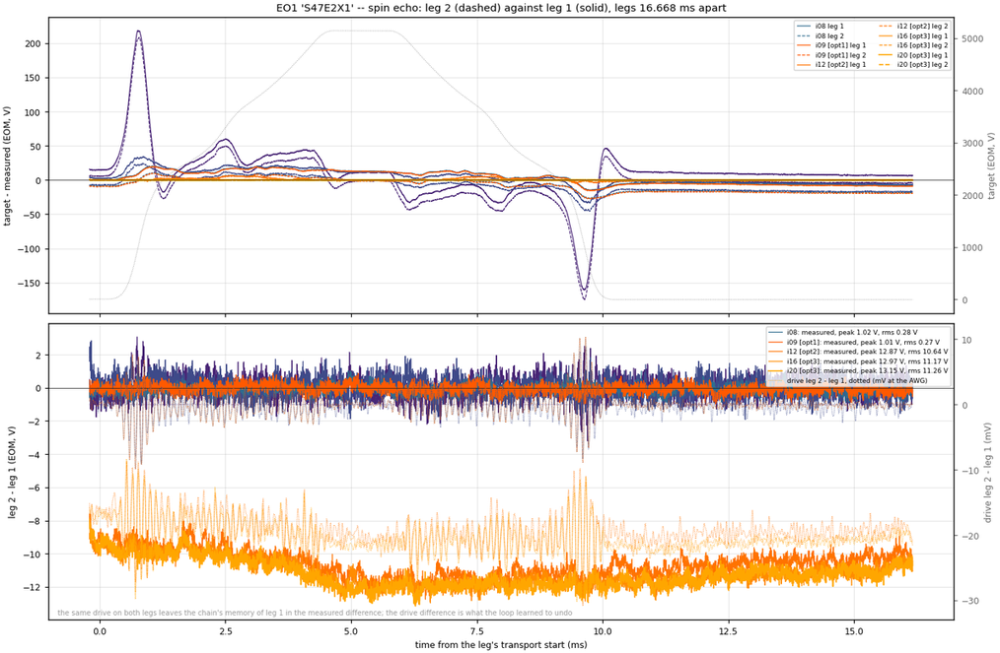

The same drive on both legs leaves only the chain's memory of leg 1 in the measured difference. The drive difference is
what the loop learned to undo. After an optical correction the measured difference is the per-leg correction the light
asked for.

### 7.5 Optical iterations are drawn in warm colours

Every iteration measured after an optical correction took effect is drawn in warm colours and tagged `[optN]` in the legend,
N being the optical pass. Electrical iterations keep a cool scale (purple to green).

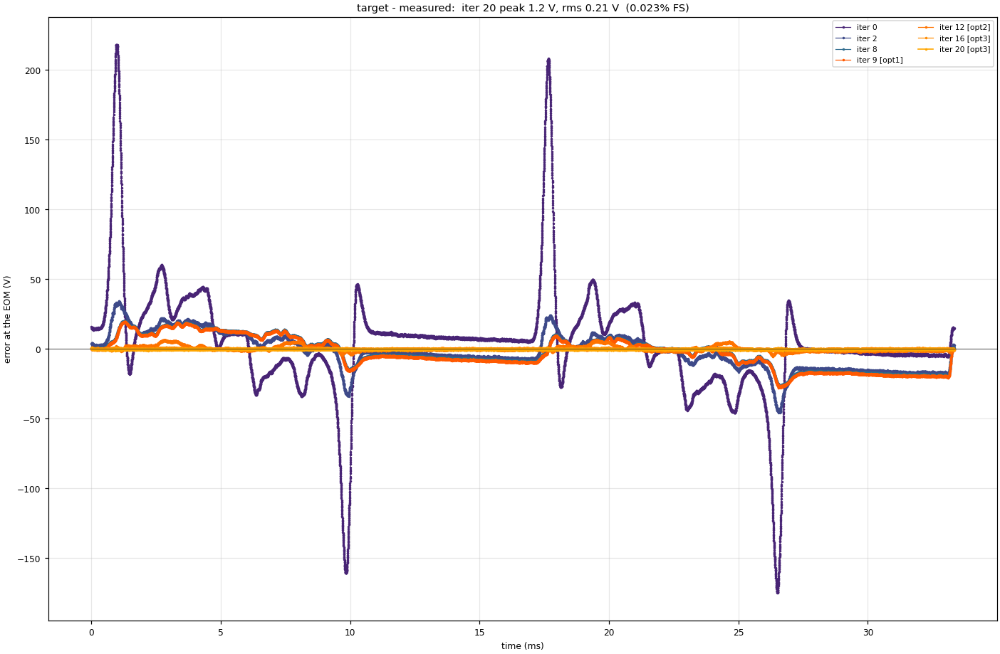

On Convergence the same iterations carry hollow red diamonds, with a dashed line labelled `optical pass N applied` where each
pass took effect:

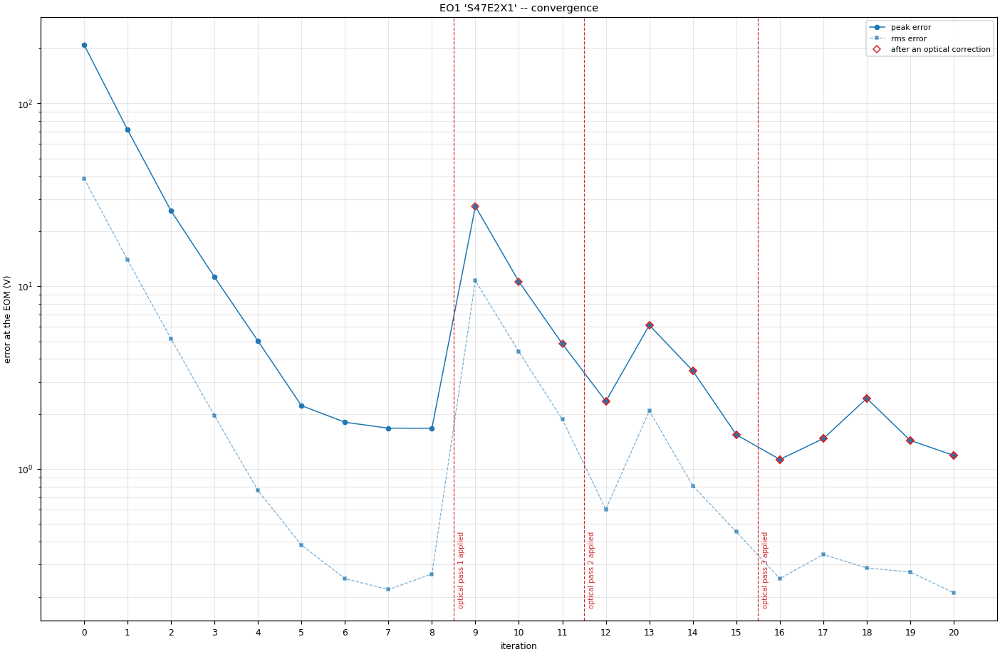

### 7.6 Diagnostics -> pd

The analyzer photodiode per stored iteration (top) and each iteration's PD minus the last one in mV (bottom), with each
iteration's monitor rms in the legend.

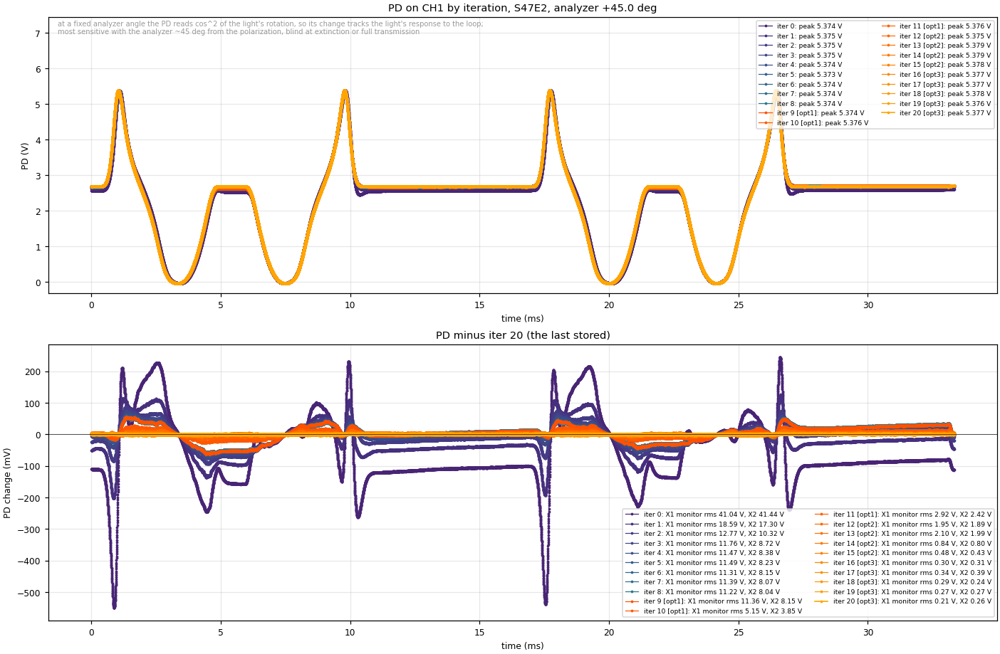

At a fixed analyzer angle the PD reads the cosine squared of the light's rotation, so its change tracks how the light
answered each update. It is most sensitive with the analyzer about 45 degrees from the polarization, and blind at extinction
or full transmission. The title names the analyzer angle (here +45.0 degrees).

---

## 8. Reports and figures

Two tools read the run folder after (or during) a campaign. Neither opens an instrument. Both take the Anaconda
interpreter, run from the EOM-ILC folder.

### 8.1 The report

```
C:\ProgramData\anaconda3\python.exe tools\campaign_report.py "<campaign folder>" --plan "<campaign folder>\plans\00d_all_31_as_run.json" --log run\campaign-20261014\batch_all.log --figures
```

- It fills the empty columns of the campaign folder's `campaign_manifest.csv`: status, keeper iteration, final rms X1 and X2,
  leg 2 minus leg 1 at the top, light minus target, notes. The manifest CSV has to exist already (the brief ships it, one
  row per campaign in run order). Rerun any time. It only reads the run folder.
- It writes `campaign_report.md` in the campaign folder: one table row per campaign, then **Needs Maarten**, the list of
  flagged items.
- `--figures` also makes the figure set of every finished campaign that has none yet.

**What gets flagged**

| flag | when |
|---|---|
| FLAG leg 2 - leg 1 | at the top it exceeds the echo tolerance (below) |
| FLAG light - target at the stop | inside the hold, for a partial stop (under 180 degrees), it exceeds 250 mdeg. That moves the stop by an eighth of a step of the stop scan and the collision energy by about 6 % |
| STOP card pause | it differs from the manifest's `card_pause_ms` by more than 2 us |
| channel stopped | a channel stopped for a reason other than converged, noise floor, plateau or max iterations |
| error, optical refused | the campaign or its optical stage ended on an error |

Leg-to-leg tolerance in the light (0.1 rad of pair phase):

| records | tolerance |
|---|---|
| 180-degree records (S, C, N, RS, G180, H*, SW100, D*) | 10 mdeg |
| SF130-SF144, G160, SW30-SW90 (partial stops, 1.0 ms hold) | 20 mdeg |
| R3410 / R3425 / R3450 | 20 / 8 / 4 mdeg (shrinks with the hold) |

Flags are not stops, except the card pause. A diverged, refused or failed campaign: write the reason in `notes`, leave the
states as they are, and go on. Do not edit targets or plans to make one pass.

Reading the finished report (`campaign_report.md`): the 14-15 October campaign has 31 of 31 campaigns done, every
keeper at i20, final rms between 0.15 and 0.38 V per channel, every card pause as planned, and "nothing flagged" under
Needs Maarten. That is what the report says; the physics conclusions are Maarten's.

The report tool's heading and its sentence about the optical settings are fixed text for the 14-15 October campaign
(3 passes, 4 learning iterations, half-circle solo and verify scans). Edit the sentence if you reuse the tool for a campaign
with other settings.

### 8.2 The figure sets

`tools\campaign_figures.py` makes one set of eight figures and a README per campaign. The report's `--figures` calls it. By
hand:

```
C:\ProgramData\anaconda3\python.exe tools\campaign_figures.py "<plan>.json" S47E2 --log run\campaign-20261014\batch_all.log --copy-to "<campaign folder>\figures"
```

| figure | what it shows |
|---|---|
| fig1 targets and drives | base targets, the moved targets (what the optical passes added), the drives played now |
| fig2 monitor error iterations | target minus measured monitor through the iterations |
| fig3 convergence | peak and rms error per iteration, optical passes marked |
| fig4 drive noise | the drive's spectrum against the target's shape; content above the loop band on the hold |
| fig5 light, monitors, target | per joint scan |
| fig6 light minus target, passes | light minus target through the passes, with the attribution |
| fig7 echo legs | the second transport against the first, for monitors and light |
| fig8 data quality | PD screen use, fit residuals, shots, analyzer zero |

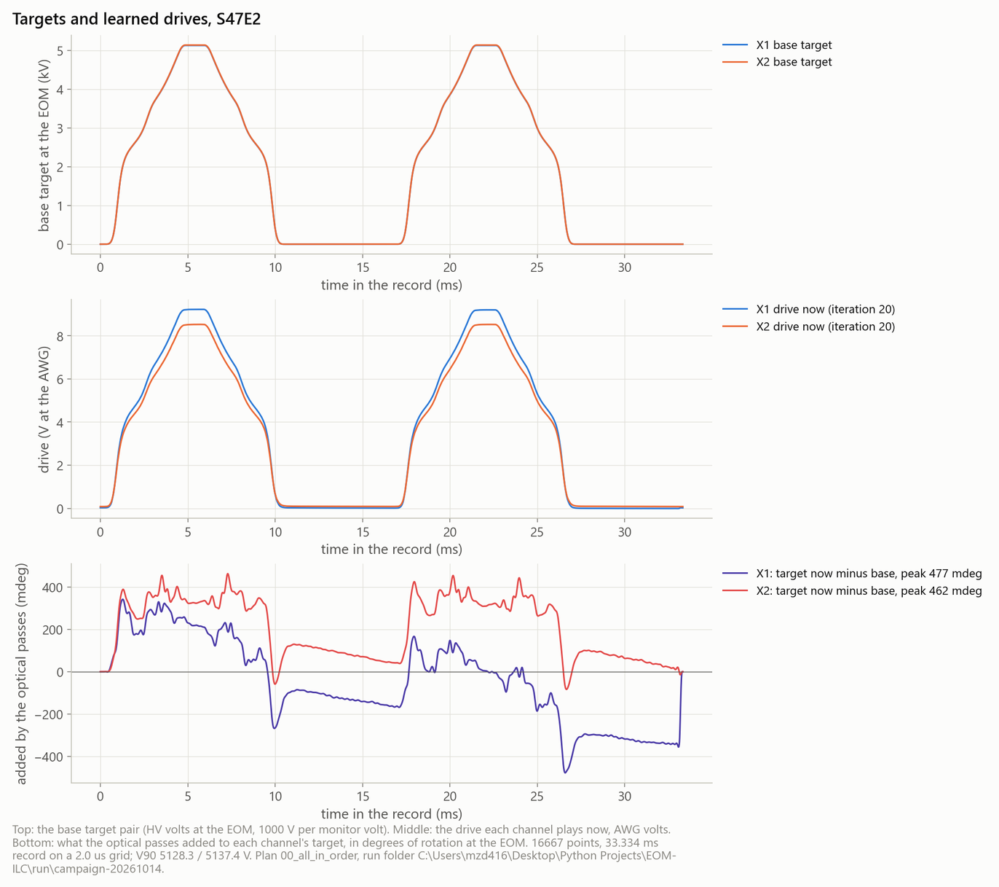

The README beside the figures carries the numbers (electrical rms by iteration, the optical table, the leg differences, the
data-quality lines).

### 8.3 Where things land on OneDrive

```
Share Data\Ramps\campaign-20261014\
  START_HERE.md              the brief
  campaign_manifest.csv      one row per campaign
  campaign_report.md         the report
  plans\                     the batch plans (00d_all_31_as_run.json is the plan as run)
  targets\                   the target pairs and the echo records
  designs\                   how the five new targets were made
  figures\<stem>\            the eight figures and a README per campaign
  supertime\                 the custom-ramp chunks (chapter 9)
  handbook\                  this handbook
```

The figures are made in the run folder (`run\campaign-20261014\figures\<stem>\`) and mirrored to OneDrive with `--copy-to`.

---

## 9. Exporting for Supertime

Supertime is the experiment's sequence control program. Its custom-ramp build takes ramp shapes from CSV files. The Batch
window's **Export for Supertime...** cuts the closed drives of a campaign into the chunks it takes.

### 9.1 In the panel

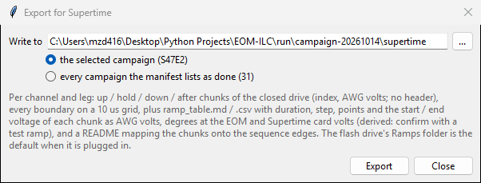

1. In the Batch window, select a campaign (or none).
2. Press **Export for Supertime...**.
3. **Write to**: the folder. The default is the flash drive's Ramps folder when it is plugged in, otherwise a `supertime`
   folder in the run folder.
4. Choose **the selected campaign** or **every campaign the manifest lists as done**.
5. Press **Export**. It is file work only (no instrument) and logs each record.

The command-line twin:

```
C:\ProgramData\anaconda3\python.exe tools\supertime_chunks.py "<plan>.json" "<out folder>" [stem ...]
```

Without stems it exports every campaign the plan's manifest lists as done.

### 9.2 What comes out

One folder per record (`S47E2`, `SF130E2`, ...), holding for each channel:

- `<stem>_<X1|X2>_full_keeper.csv`: the full closed drive on the 2 us grid, AWG volts.
- `<stem>_<X1|X2>_leg<1|2>_<up|hold|down|after>.csv`: the chunks.

In the export folder: `ramp_table.md` and `ramp_table.csv`, and a README.

Each chunk is a two-column CSV, comma separated, **no header**: `index, value`. The values are the closed drive in AWG
volts. Supertime interpolates at its step and rescales the shape onto the cell voltages, so only the shape matters, not
the scale. Every boundary sits on a 10 us grid, so a 10 us step fits every chunk exactly.

| chunk | runs from | to | sequence edges (leg 2 has the `1: ` prefix) |
|---|---|---|---|
| up | 100 us before the target's rise starts (the drive leads the target) | 200 us into the flat top | EO ramp up 0 to EO ramp up 3 |
| hold | 200 us into the flat top | 200 us before its end | EO ramp up 3 to EO ramp down 3 (a Custom cell with time constant 1 at up 3) |
| down | 200 us before the flat top's end | 100 us after the fall | EO ramp down 3 to EO ramp down 0 |
| after | 100 us after the fall | 100 us before the next leg's rise (leg 1), or the record's end (leg 2) | EO ramp down 0 to 1: EO ramp up 0 (leg 1), a Custom cell at down 0 |

The hold and after chunks carry the optical close's slow corrections (the creep over the hold, the relaxation after the
fall).

**ramp_table.md** lists, for every chunk: record, channel, leg, chunk, start and end time (us), duration (us), step (us),
points, and the start and end voltage in three forms:

- AWG volts, as played on the bench through the 4063B, the preconditioning stage and the Trek;
- degrees of rotation at the EOM, from the measured chain gains (557 V per AWG volt on X1, 601 on X2, the linear region)
  and V90 (5128.3 / 5137.4 V);
- Supertime card volts, converted from degrees with the day-log reference voltages (11.412 V X1, 9.99 V X2).

**The card-volt column is derived. Confirm it with one test ramp on the Trek monitor before trusting the absolute level.**
A chunk whose ends differ by under 2 mV is marked a **held value**: set its cells, no shape is needed, and the ramp
numbering drops by one for each such chunk left out.

### 9.3 Putting the chunks into a sequence

This is the sequence editor's side. The details are in `CUSTOM_RAMP_BRIEF.md` (on the Desktop) and in the export's own
README. In outline:

1. Use the custom-ramp build `supertime-CustomRamp-ExternalTrigger-pauseChannelUpdateV0.vi` (9 October). Do not use the
   newer `...(1009).vi`.
2. Set each ramp's start and end cells to the table's Supertime card volts, and its duration and step to the table's.
3. The ramp numbering (option 2 of the brief, one Custom ramp for each of up, hold, down and after): leg 1 is ramps 128 (up),
   129 (hold), 130 (down), 131 (after); leg 2 is 132 to 135. `ramp path.csv` rows 47 (Trek X#1) and 48 (Trek X#2) must be
   pointed at the files accordingly. Anything that adds or removes an enabled Trek ramp before the echo shifts the numbers.
4. Both channels ramp on the same edges with the same step.
5. Sum of the four chunks' durations equals the 16.668 ms leg spacing.

**Before the first run, one test ramp.** One detail of how Supertime rescales a shape is unverified: whether it is exactly
`(f - f_first) x (v_end - v_start) / (f_last - f_first)`. Load a chunk, set its cells to the table's voltages and compare
Supertime's Channel Plot, or the Trek monitor on a scope, with the chunk's shape.

---

## 10. Known traps and what they look like

**The panel keeps its old code (the stale-panel guard).**
After you pull new code, a running panel still runs the old code. Check plan, Simulate, Run on bench and Preview therefore
refuse when a program file has changed on disk since the panel started:
"the program changed on disk since this panel started ... restart it (close and start ilc_gui.bat)". Restart the panel.

**A scope read fails with `invalid literal for int() with base 10: b''`.**
The scope returned an empty data block, roughly one read in 30 on the campaign night. The reads are retried in place, and a
shot that stays unreadable is dropped. The log says `N of M shots kept`. A campaign is refused only when fewer than 90 % of
its shots (and at least 4) can be read. On 14-15 October 26 reads were retried and none was dropped. Nothing to do unless
a campaign is refused for too few shots.

**The mains-ripple warning on every correction file.**
The log carries "the file does not say line (mains) ripple was removed. On a line-synchronous trigger the ripple is
phase-locked to the record and would be learned as error". It appears on every correction file from the optical stage. At
1.0104 Hz the mains phase moves by 0.382 of a cycle per shot, so the shot average washes the ripple out and the warning is
expected. It would matter on a line-synchronous trigger (1.000 Hz).

**X2 cannot go much past its 90-degree point.**
X2's preconditioning stage before the Trek saturates near 5575 V on the hold. A record must keep X2 at or under its
90-degree point (5137 V). Symptom (15 October): the limit check fails at about iteration 9 with "AWG peak 10.068 V exceeds
the 10.0 V rail by 68 mV", and X2's error sits near 30 V rms from iteration 2 while X1 converges. Fourteen records
(SF130-SF144, SW30-SW100 and HS81) had X2 driven to 5651 V, 110 % of its V90. They were rebuilt so that X2 ends at its
90-degree point (HS81 became HS90) and then trained and closed. The originals are in the campaign's
`targets\original_X2_99deg`.

**"edges sampling-limited" in the scan log.**
The scan prints `sampling: <dt> us, <x> deg per sample at <y> deg/ms - WARN: edges sampling-limited` when the polarization
turns by more than 0.3 degrees between two readout samples on the steepest edge. The scan goes on. The optical numbers on
that edge are then limited by the sampling. The plan's `scan.sample_us` 2.0 keeps the readout on the loop's own grid.

**A scan is refused: the PD never rises above 50 mV.**
The text is "the PD on CHn never rises above N mV: the light is off or the beam is blocked". Turn the light on or unblock
the beam. The campaign is recorded as `optical refused` and a plain rerun repeats the stage.

**A scan is refused: the folder on disk holds dark steps.**
The text is "scan refused: <name> on disk holds N of its M done steps scanned with no light on the PD ...; delete
<folder> and scan again". A scan that was started with the light off is on disk and would be resumed. Delete that scan's
folder under the campaign's `optical\` folder and run again. A scan stopped with the light on resumes from disk by itself.

**A campaign is refused: the state holds a different target.**
See section 4.5. Move the old states aside or rename the campaign.

**The Hardware row says "in use".**
Another program holds that device: the polarimeter on COM3 or the DS345, Scope Grab on the scope, the AWG GUI on the
generator. Close it.

**Auto-set refuses.**
An output is ON. See section 2.5 before switching anything.

**A different record length needs Auto-set.**
Under DDS the generator plays the whole record in one FRQ period. A record of another length needs Auto-set (outputs OFF)
before it plays at the right speed. The batch sets FRQ itself between campaigns, under a parked output.

**HRES, never AVER.**
Bench mode refuses the scope's averaging acquisition. The 64 software repeats are the averaging.

**Where to ask.** Anything the report flags, a campaign that diverges or is refused, a plan that would need a different
trigger rate, amplitude, offset or limit: ask Maarten before changing anything.

---

## 11. One-page checklist for a campaign day

1. Close the AWG GUI, Scope Grab and the polarimeter. Start the panel with `ilc_gui.bat` (restart it if the code changed).
2. Hardware tab: Check all four. Scope, AWG, ELL14 (COM3) and DS345 answer, none "in use".
3. Scope tab: CH1 PD, CH2 CmdX1, CH3 MonX1, CH4 MonX2.
4. DS345 trigger at 1.0104 Hz. Light on, beam unblocked.
5. Run tab: Auto-set instruments (outputs OFF at the start; do not switch an output off by hand otherwise).
6. The P92 state files exist in `run\`. The plan's `run_dir` is new, or you mean to resume it.
7. Batch window: Reload, Check plan, Preview. Dry run on the command line if you run headless.
8. Run on bench (Yes in the dialog), or the headless command. Do not touch the instruments from the panel during a
   headless run.
9. Watch the status line and the Optical stage table. A campaign takes about 31 minutes.
10. Afterwards: `tools\campaign_report.py ... --figures`. Read **Needs Maarten**. Check the card pauses.
11. Export for Supertime when the records are wanted. One test ramp before the first use.
12. Both outputs are left parked and ON. Leave them parked.
